# HTTP & DNS Security Log Analysis

<h2>Description</h2>

This phase documents the ingestion and analysis of simulated HTTP and DNS security logs using Splunk Enterprise. The goal of this phase was to develop practical security investigation skills by examining web traffic, DNS queries, and network-related activity to identify suspicious behavior and potential security threats.

Building on the SPL analysis techniques introduced in Phase 2, this phase focused on investigating network activity, identifying abnormal traffic patterns, and correlating HTTP and DNS events to better understand potential security incidents.

 In this phase, the following tasks were completed:

- <b>Ingested simulated HTTP and DNS security logs into Splunk</b>
- <b>Examined raw events and extracted fields</b>
- <b>Analyzed HTTP methods and response status codes</b>
- <b>Identified suspicious HTTP source IP addresses</b>
- <b>Investigated web reconnaissance and repeated authentication attempts</b>
- <b>Analyzed HTTP user-agent strings</b>
- <b>Examined HTTP errors and request patterns</b>
- <b>Visualized suspicious HTTP activity over time</b>
- <b>Investigated DNS queries and response codes</b>
- <b>Identified unusual DNS query frequencies and source IP addresses</b>
- <b>Examined randomly generated domain names</b>
- <b>Investigated repeated NXDOMAIN responses</b>
- <b>Analyzed potential automated DNS activity</b>
- <b>Correlated HTTP and DNS activity by source IP address</b>
- <b>Validated the security datasets using SPL statistical analysis</b>

This phase strengthened practical network security monitoring, log analysis, and investigation skills relevant to Security Operations Center (SOC) environments. The findings also provide a foundation for developing security detection rules and automated alerts in subsequent phases.

 

<h2>Languages and Utilities Used</h2>

- <b>Splunk Enterprise 10.6.1.1</b>
- <b>Splunk Processing Language (SPL)</b>
- <b>Simulated HTTP Security Log Dataset</b>
- <b>Simulated DNS Security Log Dataset</b>
- <b>Web Browser</b>

<h2>Environments Used</h2>

- <b>Host Operating System: Windows 11</b>
- <b>Virtualization Platform: Oracle VirtualBox</b>
- <b>Splunk SIEM Server: Ubuntu Server 24.04.5 LTS</b>
- <b>Splunk Server IP Address: 192.168.56.20</b>
- <b>Splunk Index: network_security</b>
- <b>HTTP Sourcetype: phase3_http_security</b>
- <b>DNS Sourcetype: phase3_dns_security</b>

<h2>Program walk-through:</h2>

<b>Step 1 – Ingest HTTP and DNS Security Logs</b>  
Imported simulated HTTP and DNS security log datasets into Splunk Enterprise using the Add Data interface. Configured the network_security index and assigned the phase3_http_security and phase3_dns_security sourcetypes. Verified that both datasets were successfully ingested and searchable using SPL queries: 
<a href="https://raw.githubusercontent.com/royalexvo/Splunk-SIEM-Detection-SOAR-Automation-Phase-3/main/Step1.png">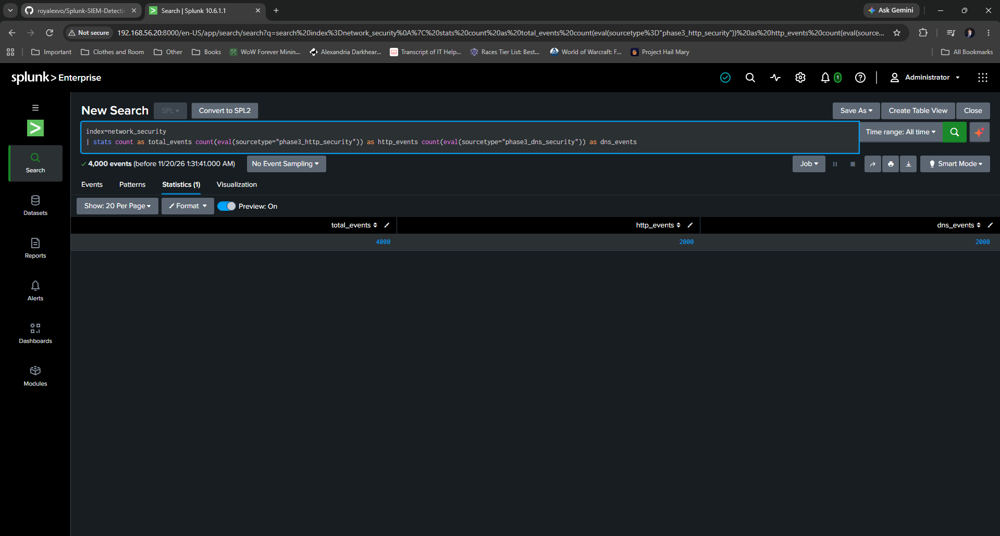</a>

<b>Step 2 – Examine Raw HTTP and DNS Events</b>  
Examined raw HTTP and DNS security events to understand the information recorded in each dataset. Reviewed timestamps, source IP addresses, HTTP methods, requested URIs, response status codes, DNS queries, record types, and response codes. Identified searchable fields used throughout the investigation: 
<a href="https://raw.githubusercontent.com/royalexvo/Splunk-SIEM-Detection-SOAR-Automation-Phase-3/main/Step2.png">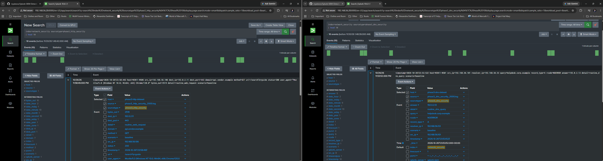</a>

<b>Step 3 – Analyze HTTP Methods and Status Codes</b>  
Used SPL statistical commands to examine HTTP request methods, including GET, POST, PUT, and DELETE. Analyzed response status codes to distinguish successful requests, redirects, client errors, and server errors. Established a baseline understanding of HTTP activity before investigating suspicious traffic patterns: 
<a href="https://raw.githubusercontent.com/royalexvo/Splunk-SIEM-Detection-SOAR-Automation-Phase-3/main/Step3.png">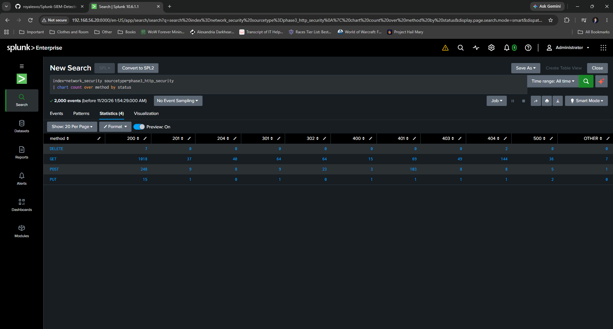</a>

<b>Step 4 – Identify Suspicious HTTP Source IP Addresses</b>  
Grouped HTTP requests by source IP address using SPL statistical commands to compare request volumes across clients. Identified two suspicious source IP addresses requiring further investigation: 198.51.100.44 generated 110 requests, while 198.51.100.77 generated 90 requests. Examined their HTTP methods, response codes, and requested endpoints to distinguish their activity from routine web traffic. These addresses belong to reserved documentation ranges used in the simulated dataset: 
<a href="https://raw.githubusercontent.com/royalexvo/Splunk-SIEM-Detection-SOAR-Automation-Phase-3/main/Step4.png">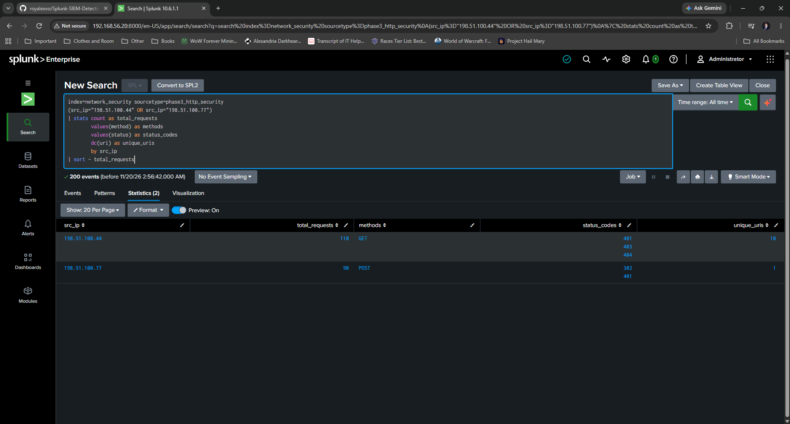</a>

<b>Step 5 – Investigate Web Reconnaissance and Authentication Attempts</b>  
Investigated suspicious HTTP activity associated with 198.51.100.44 and 198.51.100.77. Identified repeated GET requests from 198.51.100.44 targeting potentially sensitive endpoints, including /admin, /.env, /config.php, /backup.zip, and /phpmyadmin, with HTTP 401, 403, and 404 responses. Additionally, identified 89 HTTP 401 Unauthorized responses followed by one HTTP 302 redirect from 198.51.100.77 targeting the /login endpoint. These patterns were consistent with simulated web reconnaissance and repeated authentication attempts, although the redirect alone did not confirm successful authentication: 
<a href="https://raw.githubusercontent.com/royalexvo/Splunk-SIEM-Detection-SOAR-Automation-Phase-3/main/Step5.png">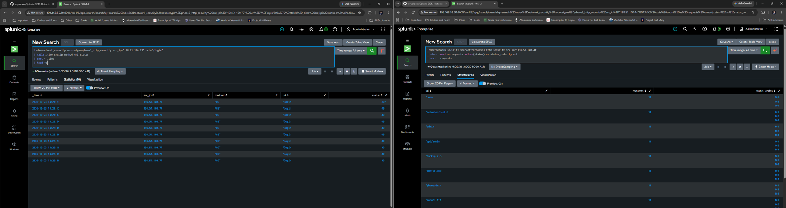</a>

<b>Step 6 – Analyze HTTP User-Agent Activity</b>  
Used SPL to summarize HTTP requests by user-agent string. Compared common browser identifiers, including Chrome and Firefox, against automated clients such as curl and python-requests. Identified 200 requests using python-requests/2.31.0, demonstrating how user-agent analysis can help identify potentially automated HTTP activity: 
<a href="https://raw.githubusercontent.com/royalexvo/Splunk-SIEM-Detection-SOAR-Automation-Phase-3/main/Step6.png">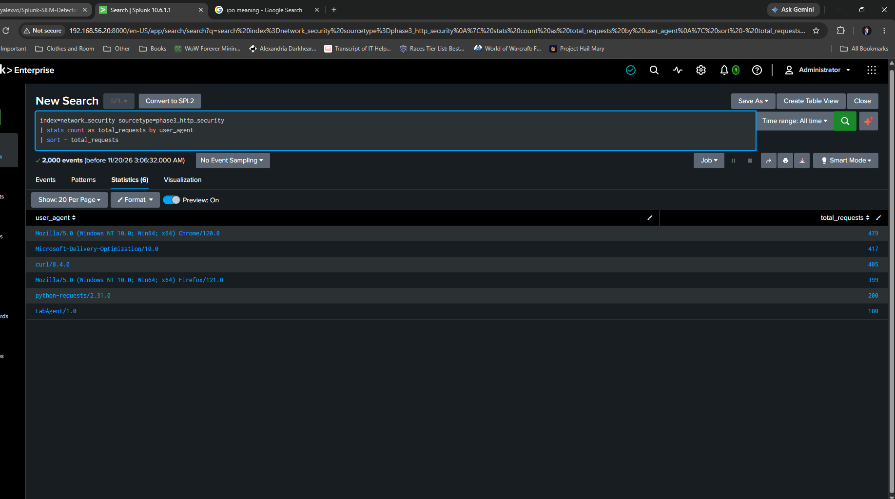</a>

<b>Step 7 – Correlate HTTP Requests, User Agents, and Response Codes</b>  
Used SPL statistical commands to correlate HTTP request volumes with source IP addresses, user-agent strings, request methods, and response status codes. Confirmed that 198.51.100.44 and 198.51.100.77 used python-requests/2.31.0, supporting the assessment that their suspicious HTTP activity was automated. Compared these findings against other clients exhibiting more varied HTTP behavior: 
<a href="https://raw.githubusercontent.com/royalexvo/Splunk-SIEM-Detection-SOAR-Automation-Phase-3/main/Step7.png">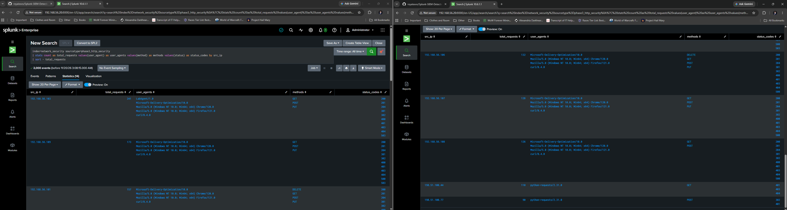</a>

<b>Step 8 – Visualize Suspicious HTTP Activity Over Time</b>  
Used the SPL timechart command with one-minute intervals to visualize HTTP request activity from 198.51.100.44 and 198.51.100.77. Identified concentrated request activity occurring during separate periods on October 22 and October 23, 2026. The visualization demonstrated how time-based analysis can reveal bursts of automated traffic that may be difficult to identify through individual events: 
<a href="https://raw.githubusercontent.com/royalexvo/Splunk-SIEM-Detection-SOAR-Automation-Phase-3/main/Step8.png">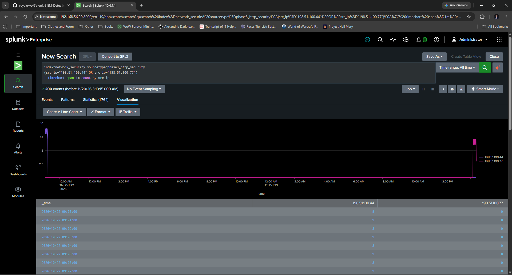</a>

<b>Step 9 – Examine DNS Queries and Response Codes</b>  
Investigated the DNS security dataset by grouping requests according to queried domain names and response codes. Examined frequently queried domains, including internal corporate and simulated vendor domains, while identifying successful resolutions and failed queries. Used SPL statistical analysis to establish an understanding of DNS activity before investigating suspicious hosts: 
<a href="https://raw.githubusercontent.com/royalexvo/Splunk-SIEM-Detection-SOAR-Automation-Phase-3/main/Step9.png">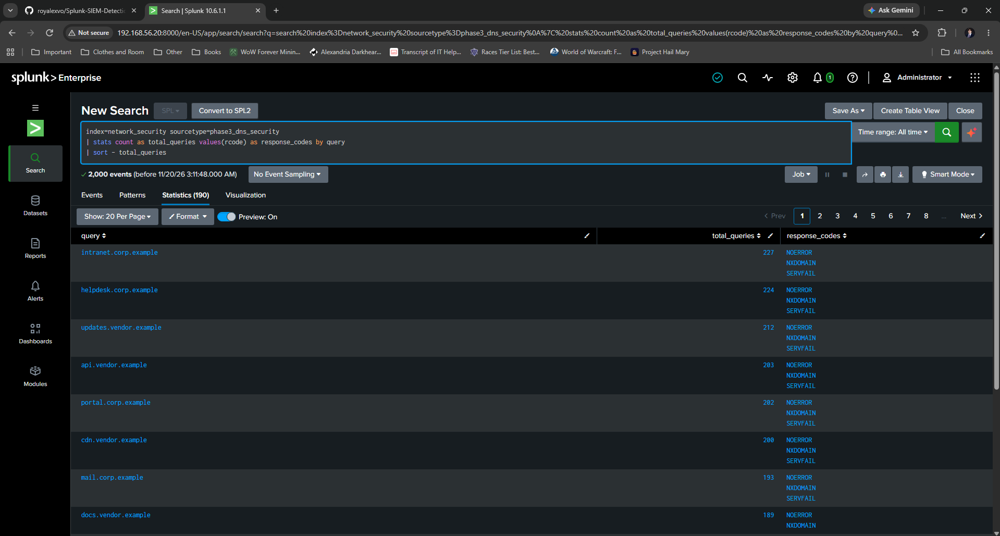</a>

<b>Step 10 – Identify Hosts Generating Failed DNS Queries</b>  
Filtered DNS events for NXDOMAIN responses and grouped the results by source IP address. Identified 192.168.56.104 as the most suspicious source, generating 96 failed DNS queries involving 92 unique domain names. Many of these domains contained randomly generated strings ending in .invalid, indicating unusual DNS behavior that warranted further investigation: 
<a href="https://raw.githubusercontent.com/royalexvo/Splunk-SIEM-Detection-SOAR-Automation-Phase-3/main/Step10.png">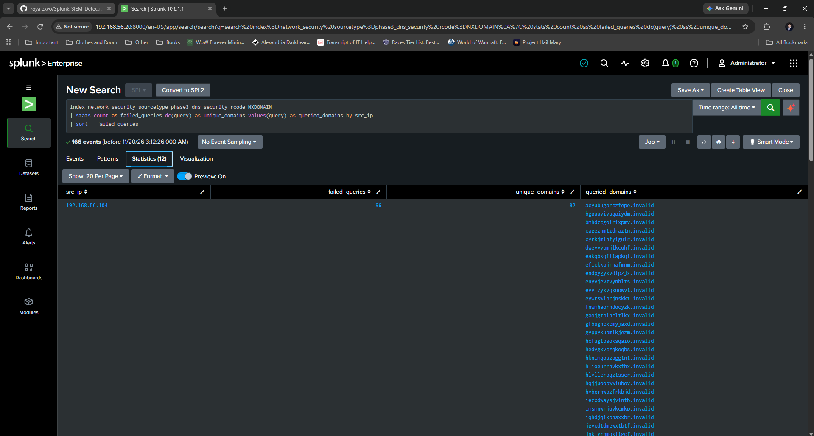</a>

<b>Step 11 – Investigate Suspicious DNS Domain Names</b>  
Examined individual DNS queries associated with 192.168.56.104 to investigate unusual domain patterns. Used the SPL len() function to calculate domain name lengths and reviewed DNS record types, timestamps, and response codes. Identified numerous randomly generated .invalid domains with consistent lengths, supporting the possibility of automated domain generation activity. These observations were indicators of suspicious behavior rather than confirmation of malware or a domain generation algorithm: 
<a href="https://raw.githubusercontent.com/royalexvo/Splunk-SIEM-Detection-SOAR-Automation-Phase-3/main/Step11.png">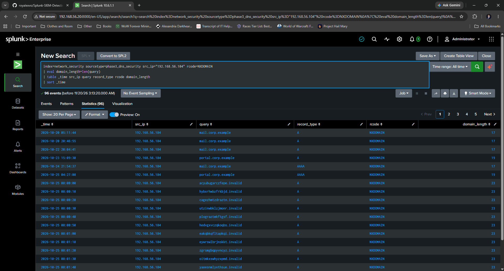</a>

<b>Step 12 – Visualize Failed DNS Queries Over Time</b>  
Used the SPL timechart command to analyze NXDOMAIN responses from 192.168.56.104 in one-minute intervals. Narrowed the search window to October 25, 2026, between 7:55 AM and 8:30 AM to isolate the suspicious activity. Identified a sustained period of six failed DNS queries per minute, demonstrating a consistent and potentially automated query pattern: 
<a href="https://raw.githubusercontent.com/royalexvo/Splunk-SIEM-Detection-SOAR-Automation-Phase-3/main/Step12.png">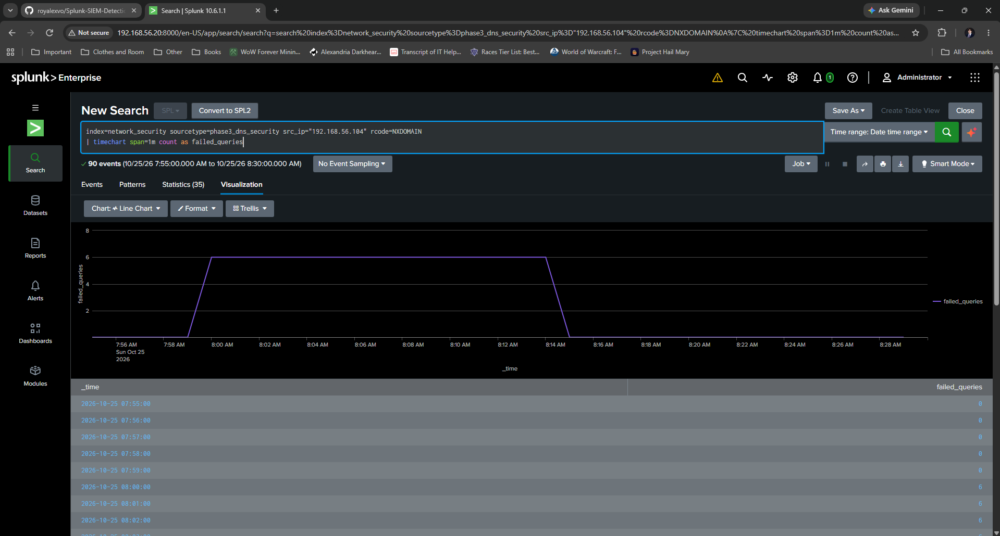</a>

<b>Step 13 – Correlate HTTP and DNS Activity by Source IP Address</b>  
Combined the HTTP and DNS security datasets using SPL to compare activity across shared source IP addresses. Calculated total events, HTTP requests, DNS queries, and associated log sources for each IP address. Identified 4,000 combined events and examined hosts appearing in both datasets, including 192.168.56.104, which generated 156 HTTP requests and 228 DNS queries. This analysis demonstrated cross-source correlation without establishing that the HTTP and DNS events were part of the same attack: 
<a href="https://raw.githubusercontent.com/royalexvo/Splunk-SIEM-Detection-SOAR-Automation-Phase-3/main/Step13.png">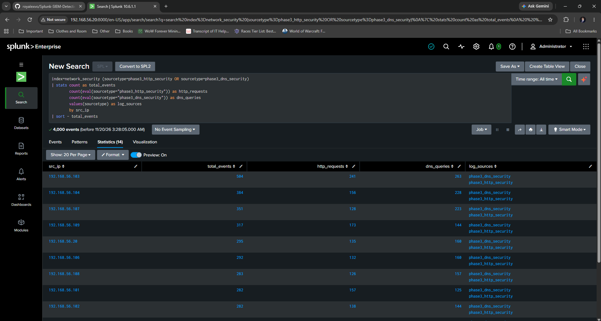</a>

<b>Step 14 – Investigate HTTP Activity Associated with a Suspicious DNS Host</b>  
Investigated HTTP activity associated with 192.168.56.104 after identifying its unusual DNS query patterns. Used SPL to group HTTP requests by URI and examine request counts, HTTP methods, response codes, and user-agent strings. Identified activity involving endpoints such as /api/v1/profile, /login, and /logout. Compared these findings against the DNS investigation to develop a broader understanding of the host's network activity without assuming the HTTP requests were malicious: 
<a href="https://raw.githubusercontent.com/royalexvo/Splunk-SIEM-Detection-SOAR-Automation-Phase-3/main/Step14.png">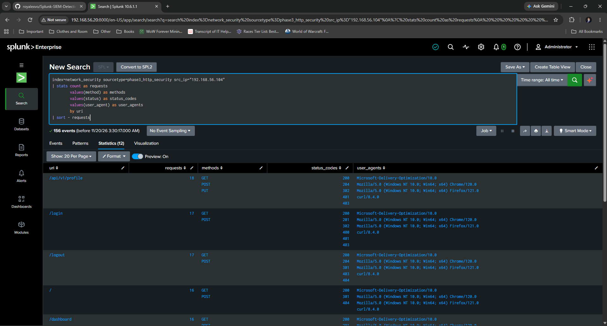</a>

<b>Step 15 – Validate Security Analysis and Complete Phase 3</b>  
Performed a final validation of the HTTP and DNS security datasets using SPL statistical commands. Confirmed that Splunk successfully indexed 4,000 events, consisting of 2,000 HTTP requests and 2,000 DNS queries from 14 unique source IP addresses. Identified 173 HTTP 401 Unauthorized responses, 58 HTTP 403 Forbidden responses, 155 HTTP 404 Not Found responses, and 166 DNS NXDOMAIN responses. These results verified the dataset totals and demonstrated the ability to investigate suspicious network activity through repeatable SPL searches, completing Phase 3: 
<a href="https://raw.githubusercontent.com/royalexvo/Splunk-SIEM-Detection-SOAR-Automation-Phase-3/main/Step15.png">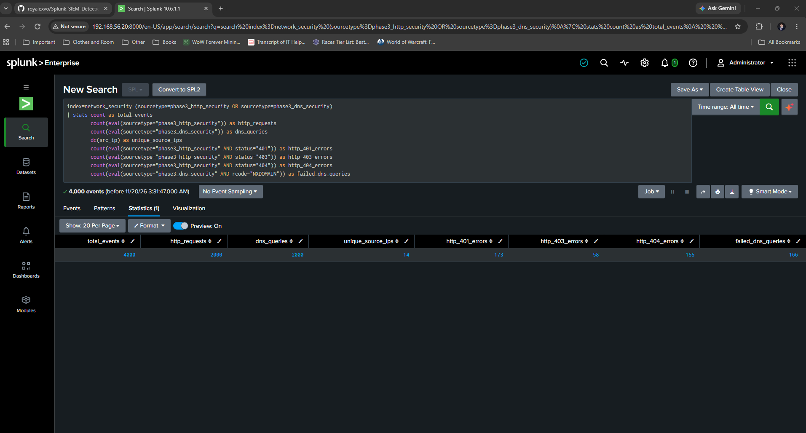</a>

